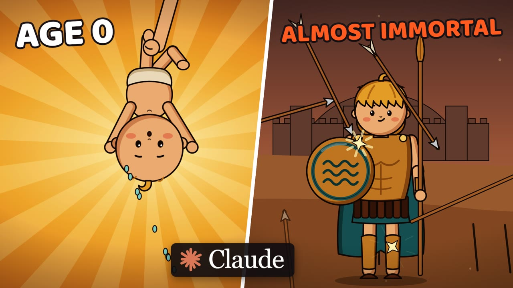
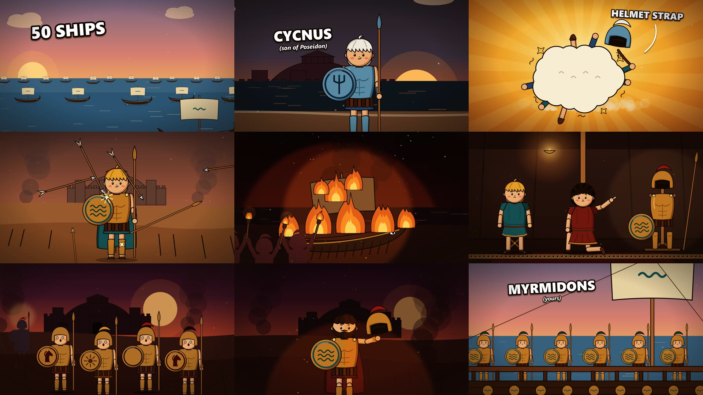
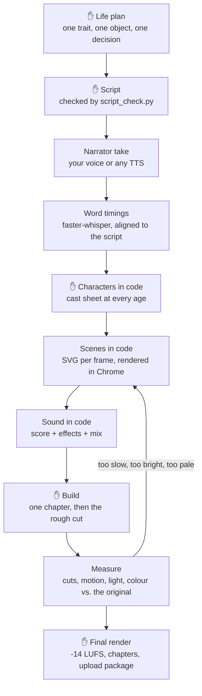
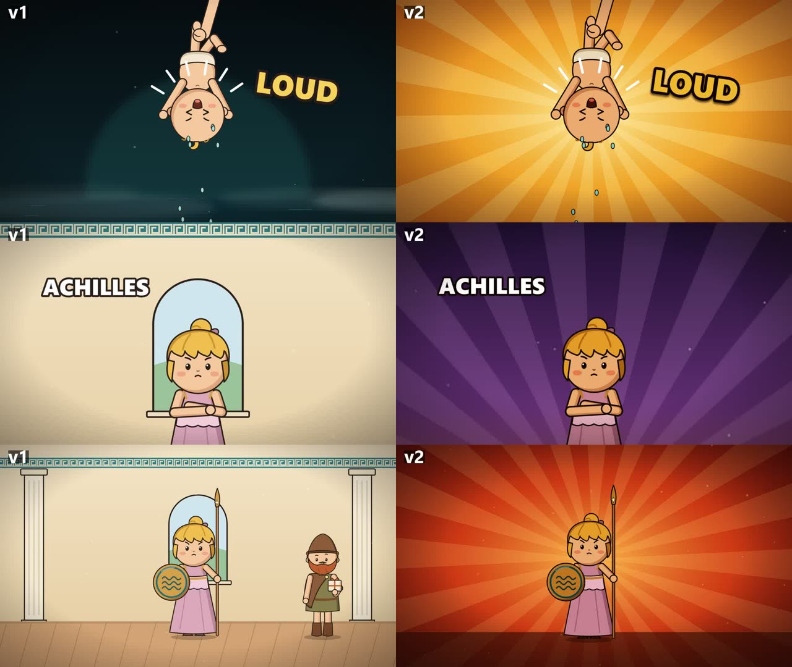

# Born in Lore Style Skill for Claude

*Unofficial. Not made, endorsed or sponsored by the Born in Lore channel or by Anthropic. See [legal notes](#legal-notes).*

The free Claude skill from the video [**"How to Make 'What If You Were Born As…' Videos Using Claude (Full Workflow)"**](https://youtu.be/hxbPiBWVA1U).

[](https://youtu.be/hxbPiBWVA1U)

It makes complete **"What if you were born as …?"** life-story cartoons in the style of [@Borninlore](https://www.youtube.com/@Borninlore):
as long as the story needs (the channel runs 7–14 minutes), a hook, a prologue and nine chapters, every frame drawn in code (SVG rendered in Chrome), the music written in code,
and the result measured against the original. No AI video generator, no drawing app, no After Effects.

Proven on a whole episode, **"What If You Were Born as Achilles?"**. It is in `example/achilles/` as a working project: characters,
sets, scenes, score and the build.



## Contents

- [What's inside](#whats-inside)
- [How it works](#how-it-works)
- [What you need](#what-you-need)
- [Install](#install) (Claude Code, by hand, the Claude app)
- [Quick start](#quick-start)
- [Render tips](#render-tips)
- [When something goes wrong](#when-something-goes-wrong)
- [The two rules behind everything](#the-two-rules-behind-everything)
- [Ground rules](#ground-rules) · [Safety](#safety) · [FAQ](#faq) · [Legal notes](#legal-notes) · [Credits](#credits)

## What's inside

| Path | What it is |
|---|---|
| `SKILL.md` | The skill: what Claude asks you first, every step from a name to a finished episode, the rules and the gotchas |
| `STYLE_BIBLE.md` | The style in numbers, measured on all six Born in Lore videos (3,611 s, 108,334 frames at 30 fps) |
| `SCRIPT_FORMULA.md` | The script formula of all six videos (hook, prologue, chapter engine, voice, jokes, arc, ending) + a fill-in template |
| `study/` | The measurements behind it: animation timing in frames, cuts / motion / light / palette per video, transcripts, all 94 effects of the Kratos video |
| `templates/LIFE_TEMPLATE.md` | The life plan to fill in (one trait, one object, one decision) |
| `tools/` | The study tools: measure any video, frame sheets, transcripts, the script checker |
| `example/achilles/` | The whole episode as a project: script, shot list, characters, props, sets, scenes, score, voice tools, build |

## How it works

Everything hangs on the narrator's words. Claude writes the script, you record or generate the voice, and faster-whisper finds the
exact time of every word. Each scene is a web page that draws frame *f* as SVG, and every cut, pop and arrow sits on a word, not
on a guessed second. Chrome renders the frames, the music and the effects are made in code, and ffmpeg puts it all together.
At the end the same tool that measured Born in Lore measures your video.



✋ = Claude shows you the result and waits for your OK.

## What you need

- **Claude.** Claude Code works best: Claude runs the tools, looks at its own renders and measures the result. It also works in the
  [Claude app](#in-the-claude-app) or in any chat (paste `SKILL.md`).
- **Node 18+**, **ffmpeg**, **Google Chrome**, **Python 3** with `numpy` and `faster-whisper`. Windows, macOS and Linux.
  No special graphics card: see the [render tips](#render-tips) for real times.
- **A narrator voice:** your own recording or any text-to-speech you are allowed to use. The script files are plain text.
- **Optional:** your own sound effects as WAV files. Without them every effect is made in code.

## Install

**The easy way (Claude Code):** open Claude Code and type

```
Install this skill: github.com/Boozymi/born-in-lore-skill
```

**By hand, Windows (PowerShell):**

```powershell
git clone https://github.com/Boozymi/born-in-lore-skill.git
New-Item -ItemType Directory -Force "$HOME\.claude\skills" | Out-Null
Copy-Item -Recurse -Force born-in-lore-skill "$HOME\.claude\skills\born-in-lore"
```

**By hand, macOS / Linux:**

```bash
mkdir -p ~/.claude/skills
git clone https://github.com/Boozymi/born-in-lore-skill.git ~/.claude/skills/born-in-lore
```

No git? Click **Code → Download ZIP**, unzip it, name the folder `born-in-lore` and put it into `~/.claude/skills/`.
Then restart Claude Code.

### In the Claude app

1. Click **Code → Download ZIP**, unzip it, rename the folder to `born-in-lore` and zip that folder again.
2. In the Claude app open **Customize → Skills → + Add → Upload skill** and pick the ZIP.
   (No Skills menu? Then your app or plan doesn't offer skills yet. Paste `SKILL.md` into the chat instead.)
3. Start a new chat with the prompt from the [quick start](#quick-start).

**To be honest about the app:** there Claude plans and writes everything with you: the life plan, the script, the shot list, the
characters, the scenes and the score. The render needs Chrome, ffmpeg and Node on your own computer, so in the app you run the build
yourself (`node tools/build_episode.mjs`). Claude Code does that part for you, and it looks at its own frames before it shows you
anything.

## Quick start

1. Make an empty project folder and open Claude Code in it.
2. Paste:

   ```
   Use the born-in-lore skill. Make "What If You Were Born as Joan of Arc?".
   Ask me your questions first, then start with the life plan and wait for my OK.
   ```

3. Claude asks you a few things first: whose life, the language, the voice, the look, the folder, the sound, your channel, your
   machine. Then it builds step by step and stops for your OK at every checkpoint: the life plan, the script (checked by
   `script_check.py`), the cast sheet, one chapter at quarter size, the rough cut with its measurement, and the final render with
   the upload package.

**Try the example first.** Copy `example/achilles/` to any folder (never build inside the skill folder), then:

```
npm install
node tools/build_episode.mjs --pieces hook --scale 0.5 --placeholder --no-join
```

`--placeholder` uses your computer's test voice, so you can see the whole chain work before you record anything.

## Render tips

Measured on an ordinary 4-core PC without a special graphics card (150 frames of the hook, 24 Nov 2026):

| `--scale` | Size | Time per frame | Disk per frame |
|---|---|---|---|
| `0.5` | 960×540 | 0.07 s | 53 KB |
| `1` | 1920×1080 | 0.10 s | 140 KB |
| `1.3333334` | 2560×1440 | 0.12 s | 210 KB |

- **Check at quarter size.** The whole hook (689 frames, 23 s of video) rendered in 41 s at `--scale 0.5` in our test on a fresh
  install. Do every check at 0.5 and only the final at 1.3333334.
- **The final episode** has about 15,000 frames. At 2560×1440 that is roughly half an hour of frames plus sound and video encoding,
  and about 3 GB of frames in `out/ep/`. Keep `out/` on a drive with space.
- **One piece at a time.** `--pieces ch3` renders only that chapter, and `--join-only` puts the finished pieces together again.
- **Only the sound changed?** `--skip-frames` keeps the frames and rebuilds only the sound and the movie.
- **Only want to look?** Render a few single frames in seconds:

  ```
  node tools/render.mjs scenes/hook.html --out out/check --scale 0.5 --frames 0,90,180,270 --query "words=../voice/hook/words.json"
  ```

## When something goes wrong

| You see | What to do |
|---|---|
| `Cannot find package 'puppeteer-core'` | Run `npm install` in your episode folder, not in the skill folder. |
| `Browser was not found at the configured executablePath` | Chrome is not in its usual place. Set `CHROME` to its path, for example `$env:CHROME = "C:\Program Files (x86)\Google\Chrome\Application\chrome.exe"` (PowerShell) or `export CHROME=/usr/bin/chromium` (macOS / Linux). |
| `ffmpeg: spawnSync ffmpeg ENOENT` (or `ffprobe`) | ffmpeg is not installed or not on the PATH. Install it, or set `FFMPEG` (and `FFPROBE`) to the full path. |
| `python: spawnSync python ENOENT` (or `python3`) | Set `PYTHON` to your Python, for example `py` on Windows. |
| `No module named 'faster_whisper'` (or `'numpy'`) | `pip install faster-whisper numpy`. If you installed them into a separate folder (`pip install --target <folder>`), set `PYLIB` to that folder. |
| `no narrator take (hook.mp3) - skipped` | Put your take into `voice/` with the file name from `episode.json`, or add `--placeholder` for a test voice. |
| `no test voice: install espeak-ng` | Linux only: install `espeak-ng`, or record the takes. |
| `<piece>: the page did not load the word timings` | The scene could not read its `voice/<words>/words.json` (`words` is the name in `episode.json`). Check that the file exists and is not empty. Delete it and build again to redo the timings. |
| `cue not found: <words>` (scene) or `cue <words>` (sound) | A scene or a score waits for words the narrator doesn't say exactly like that, because the script or the take changed. Change the phrase in that scene or score file to the words that are really spoken. |
| `shot 7 (…) does not start after shot 6` | Two shots hang on the same word, or the later one on an earlier word. Give that shot a later phrase. |
| `unknown piece "…"` | Use the ids from `episode.json`: `hook`, `prologue`, `ch1` … `ch9`. |
| It is too slow | Check at `--scale 0.5` and one piece at a time (see [render tips](#render-tips)). |

Still stuck? Paste the whole error into Claude Code. It knows these tools and can read them.

## The two rules behind everything

- **Never ask Claude what it thinks of a video. Ask it to count.** A style isn't magic. It's a list of numbers nobody bothered to
  count, and every number in this skill points to the file that proves it.
- **Measure your own video with the same tool you used on theirs.** Your eyes get used to your own work; the numbers don't.



Our first render looked finished. The measuring tool said otherwise: 14 cuts per minute (Born in Lore: 15.8–27.6), 44 % static shots,
too bright, too pale. After the fix: 20.6 cuts per minute, brightness and dark frames equal to Kratos. The whole story is in
`example/achilles/COMPARE.md`.

## Ground rules

- **Original or public-domain characters only** (myths, history, your own). Game and film characters belong to someone else.
  If you want to earn money with your channel, pick a life nobody owns.
- **The reference videos are study material.** Nothing from Born in Lore is in this repo: no videos, no frames, no audio.
  Never re-upload theirs.
- **No gore.** Deaths happen in silhouette, as cut-aways, with dust and light.

## Safety

- Everything here is plain JavaScript, Python and PowerShell. Read it before you run it, or ask Claude to explain it.
- `npm install` adds one package, `puppeteer-core`. It drives the Chrome you already have and fetches no extra browser.
- The render tool serves the episode folder to Chrome on `127.0.0.1` only, while it renders.
- No accounts, no API keys. If you use a text-to-speech service for the voice, that is between you and that service.

## FAQ

**Do I need the same voice?** No. Any calm storyteller voice works; the skill tells you the pace (about 2.5–2.9 words per second).

**Mac or Linux?** Yes. `tools/build_episode.mjs` runs everywhere. The `.ps1` files are Windows-only extras that do the same.

**Another language?** Write the script in your language and set `WHISPER_LANG` (for example `de`) before building. The formula
was measured on English videos; the structure stays the same.

**Can I make Kratos or CJ?** Technically yes. Those characters belong to their studios, so whether you make them is your own
decision and your own responsibility (see [legal notes](#legal-notes)). For a channel you want to monetise, myths, history or
your own characters are the safe choice.

**No sound effects library?** Not needed. Every effect is made in code at the right length and level; your own WAVs replace them
automatically when you add them to `sfx/`.

## Legal notes

- **Your choice, your responsibility.** What you make with this skill is entirely up to you. We only share a workflow. We don't
  decide what you create, publish or earn with it, and we are not responsible for it. Do your own research (DYOR). Nothing here
  is legal, financial or business advice (NFA).
- **No warranty, no liability.** This skill is free and provided "as is" under the [MIT license](LICENSE), without any warranty.
  The author is not liable for any damage, loss, cost, claim, strike, demonetisation or other consequence that comes from using
  it, from the videos you make with it, or from what Claude does while you use it. You use it at your own risk and check what it
  does before you run it.
- **You are responsible for what you make and publish.** Whether you have the rights to every character, story, voice, piece of
  music, sound, image, title and thumbnail in your video is yours to check. The same goes for the rules of the platforms you
  publish on (for YouTube: its Terms of Service, Community Guidelines and monetisation policies) and the terms of every service
  you use, such as a text-to-speech provider.
- **Studying other videos.** Whether you may download and analyse a video (the platform's terms, the law of your country) is your
  own responsibility.
- **Voices.** If you use or imitate the voice of a real person, getting their consent is your own responsibility.
- **No promises.** View counts and other numbers in this repo were measured on the dates given and change over time. Nothing here
  promises views, income or monetisation.
- **Not affiliated.** This project is not affiliated with, endorsed or sponsored by the Born in Lore channel, Anthropic, YouTube /
  Google, or any game, film or book studio. "Claude" is a trademark of Anthropic. All other names, characters and trademarks belong
  to their owners and are only named to describe and identify, never as a claim of rights.
- **What the license covers.** The MIT license covers the code, texts and images in this repo, which were all made for this
  project. It gives no rights to anything of others that is named here (the Born in Lore videos, game and film characters,
  trademarks).
- **Not legal advice.** If you are unsure whether you may use a character, a voice or a piece of music, ask a lawyer.

## Credits

- The style was studied on the public videos of [@Borninlore](https://www.youtube.com/@Borninlore). This project is not affiliated
  with them. All characters, art, music and code in this repo are original.
- Achilles: Greek myth. The sources and the version we follow are in `example/achilles/LIFE.md`.

## Author

Made by **Mr Boozy** with Claude.
YouTube: [Mr Boozy](https://www.youtube.com/@boozymi) · The video: [How to Make "What If You Were Born As…" Videos Using Claude](https://youtu.be/hxbPiBWVA1U)

License: [MIT](LICENSE), provided "as is" without warranty. See [legal notes](#legal-notes).
